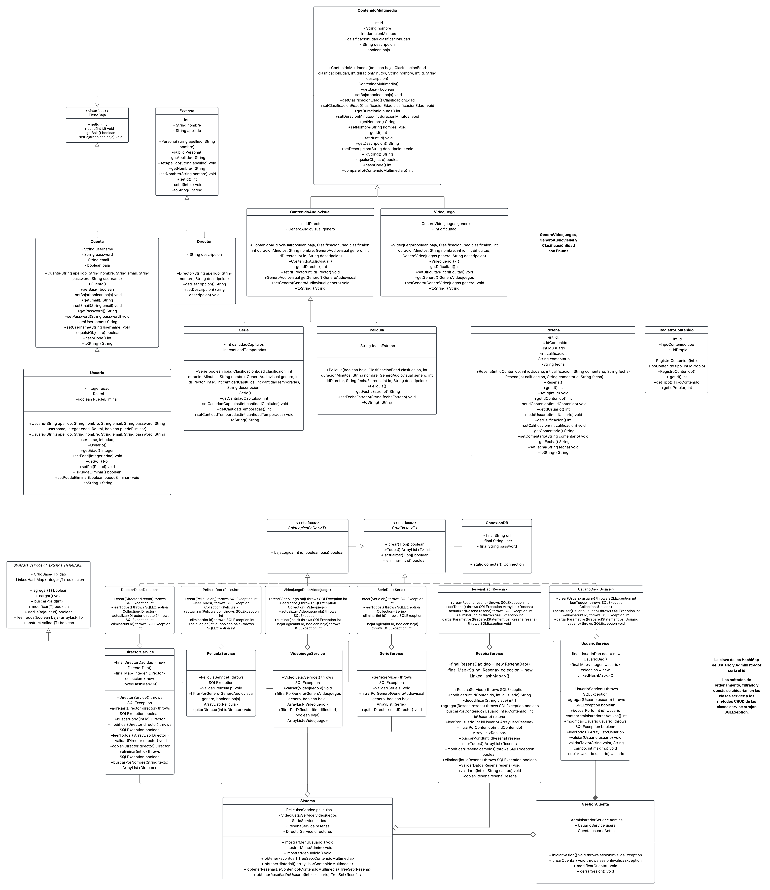

<h1>Temuflix: Catálogo de contenidos</h1>
<h2>Introducción</h2>
<h3>Integrantes del grupo</h3>

Los encargados del desarrollo de este programa fueron; Ismael Salvador Castillo, Marco Uriel 
Villaroel Buet, Dylan Nicolás Barboza y Joaquin Nemet.

<h3>Descripción del proyecto</h3>

 Temuflix es un catálogo de contenidos audiovisuales, como lo son
series, peliculas y videojuegos que permite a sus usuarios crear reseñas
y agregar a favoritos los contenidos que desee.

 El programa cuenta con dos tipos de cuenta, por un lado, el usuario, que pueda consultar 
el catálogo de series, peliculas y videojuegos, crear una reseña con calificación
y comentario para los mismos, así como agregarlos a una lista de favoritos. Por otro lado,
el administrador puede agregar, modificar y dar de baja dichos contenidos mediante un menú aparte,
además de las funciones de un usuario corriente.

El programa posee dos interfaces de ejecución, por un lado, la interfaz por consola que posee 
todas las funcionalidades planteadas del programa, y, por otro lado, la interfaz gráfica creada con JavaFX
que ofrece una experiencia más accesible para el usuario. La interfaz gráfica no posee todas las funciones
planteadas para el administrador, pero en la vista de los contenidos posee más funciones de ordenamiento.

<h2>Ejecutar el programa</h2>

 Para ejecutar el programa se deben realizar ciertos preparativos previos:

<ol>
    <li>
        
Descargar el proyecto e iniciar una conexión en Workbench.

    </li>
    <li>
        
Acceder a los archivos del proyecto y modificar el archivo <i>ConexionDB</i> en la ruta:

        <code>ProyectoFinal_C2/src/main/java/Conexion/ConexionDB</code>
        
Dentro de ese archivo se debe modificar las variables 'USUARIO' y 'PASSWORD' para que
            coincidan con su usuario y contraseña de su conexión de Workbench.
        

    </li>
    <li>
    
En workbench, se deben abrir y ejecutar los archivos 'Script.sql' e 'Inserts.sql' en dicho orden
        para crear la base de datos e insertar los datos de prueba. Estos archivos se encuentran en:
        <code>ProyectoFinal_C2/BDD</code>
    

    </li>
    <li>
        
Por último, dentro de IntelliJ, se debe abrir el proyecto y en el caso de querer entrar al
            programa por consola se debe abrir el archivo main.java y presionar ejecutar arriba a la derecha.
        

        
En el caso de querer ejecutar la interfaz gráfica se debe dirigir a la barra lateral
            a la derecha de la pantalla presionar en el apartado de Maven (Simbolizado con una 'm'),
            y luego presionar navegar en ProyectoFinal -> Plugins -> javafx -> javafx:run y ahí
            comenzará a cargar la interfaz.
        

    </li>
</ol>

Para ingresar al sistema, puede utilizar estas credenciales de prueba:

<ul>
    <i>Credenciales para administrador</i>
    <li><b>EMAIL: </b> admin@temuflix.com</li>
    <li><b>CONTRASEÑA: </b> admin1234</li>
     
    <i>Credenciales para usuario</i>
    <li><b>EMAIL: </b> usuario@mail.com</li>
    <li><b>CONTRASEÑA: </b> clave1234</li>
</ul>

<h2>Diseño del programa</h2>

El programa fue desarrollado con Java 24, JavaFX 24.0.1 y MySQL 8.0 utilizando la IDE IntelliJ y Workbench.
Para el desarrollo de la interfaz gráfica (JavaFX) se utilizó la extensión Scene Builder.

Aclaración: Las justificaciones por el uso de cada colección están en comentarios en el lugar que se
utiliza dicha colección.

<h3>Diagrama Inicial / Boceto</h3>

<h3>Diagrama final</h3>

<i>El archivo del diagrama está en la raíz del proyecto por si no se logra distinguir bien.</i>